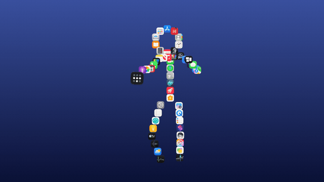
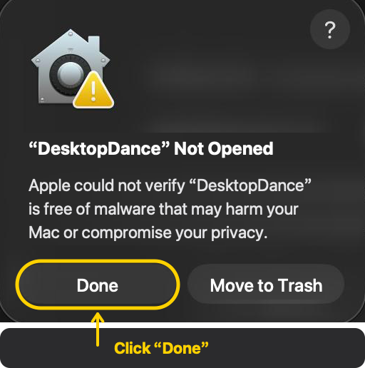
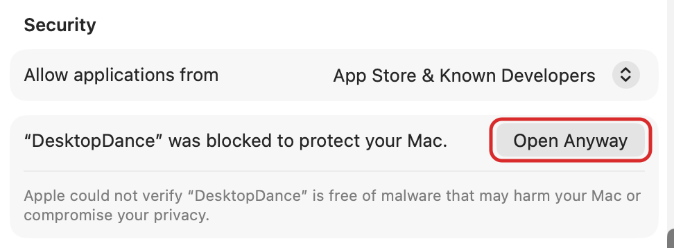
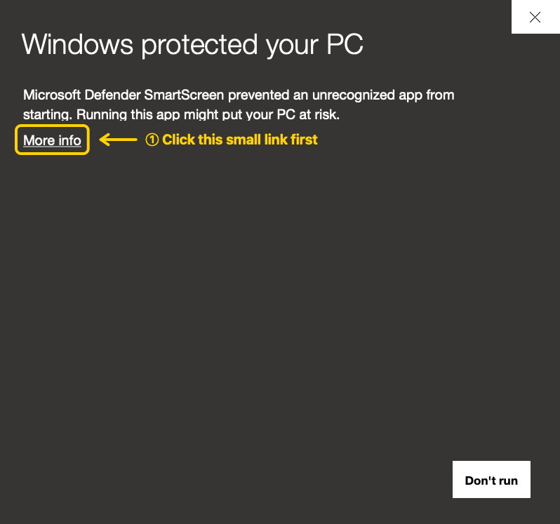
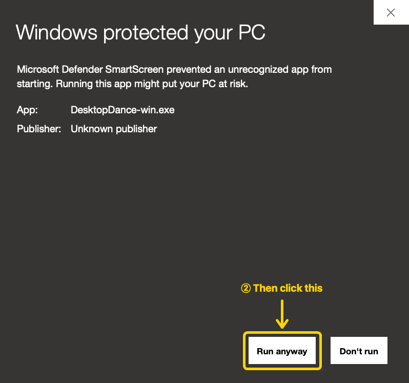
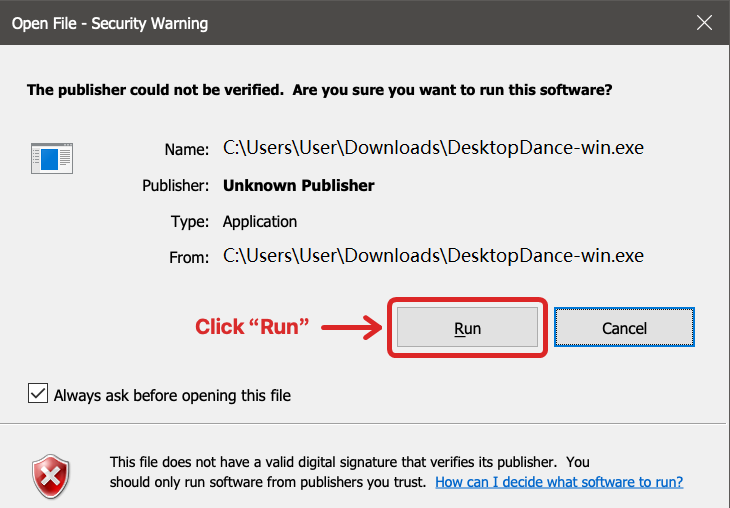
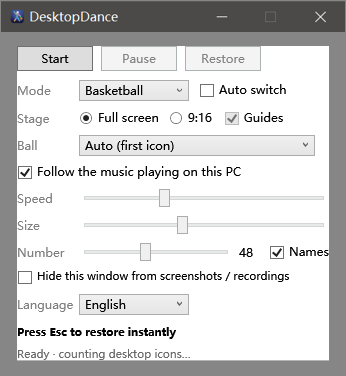

**English** | [中文](README.zh-CN.md)

# DesktopDance

**The icons on your desktop get up and play basketball.**

Click **Start** and your files and app icons assemble into a little figure that dribbles and spins. The faster your music, the faster it plays. Press `Esc` and every icon is back where it was.

- 🏀 **Four modes**: Basketball, Line, Groove, Free
- 🎵 **Follows your music**: it listens to what the computer is playing, no microphone
- 🎯 **Your own icons**: it uses whatever is on your desktop, and you pick which icon is the ball
- 🔒 **Your files are never touched**: nothing is deleted, renamed or moved; quit the app and the desktop is as it was
- 💻 **Mac and Windows**, free for noncommercial use, source code available



## Download

<a href="https://github.com/jiafufang63-cpu/DesktopDance/releases/download/mac-v1.0/DesktopDance-mac.zip"></a>
&nbsp;&nbsp;
<a href="https://github.com/jiafufang63-cpu/DesktopDance/releases/download/win-v1.0/DesktopDance-win.exe"></a>

Click a button and the download starts. No sign-up, no login.

- **Not sure which computer you have?** An Apple logo in the top-left corner of the screen means Mac; a four-square logo at the bottom of the screen means Windows.
- **Mac** needs macOS 14.2 or later. To check: click the Apple logo in the top-left corner → "About This Mac".
- **Windows** needs 64-bit Windows 10 or Windows 11. It has been tested on Windows 10; Windows 11 has not been tried yet, so if you hit a problem please [tell me here](https://github.com/jiafufang63-cpu/DesktopDance/issues/new) (needs a free GitHub account).

The app's own window is available in English and Chinese on both Mac and Windows. It follows your system language the first time; you can switch at the bottom of the window (**Language**).

The screenshots of system messages below were captured on Chinese-language systems and re-labelled in English, so fonts and spacing may differ slightly from yours.

## Mac: how to open it (a few extra clicks, first time only)

**Step 1: Unzip.** When the download finishes, open your Downloads folder, find `DesktopDance-mac.zip` and double-click it. A new item called `DesktopDance` (a colourful little figure) appears next to it. (If you downloaded with Safari, it is usually unzipped already: `DesktopDance` is sitting in Downloads, so go straight to step 2.)

**Step 2: Double-click `DesktopDance`.** You will see the message below. This is normal: Apple shows it for every free app whose author has not paid Apple for a certificate, and it does not mean anything is wrong. Click **Done**. (Do not click "Move to Trash".)



**Step 3: Tell your Mac you want to open it.** Click the Apple logo in the top-left corner → **System Settings** → **Privacy & Security** on the left → scroll all the way down on the right to "Security". There is a line saying DesktopDance was blocked; click **Open Anyway** next to it.



**Step 4: Confirm.** Another window appears; click **Open Anyway**, then type your Mac's password (or use Touch ID).

Done. From now on, just double-click `DesktopDance`; you will not need these steps again.

> Cannot find "Open Anyway"? Go back, double-click `DesktopDance` once more, click Done, and then look in Privacy & Security straight away. The button only appears right after the app has been blocked.

## Windows: how to open it (a few extra clicks, first time only)

You need 64-bit Windows 10 or Windows 11.

**Step 1: Keep the downloaded file.** After you click the download button above, your browser may hold the file back and say it "isn't commonly downloaded" or "may be harmful". This is normal: every new app whose author has not paid Microsoft for a certificate gets this message, and it does not mean anything is wrong.

- In **Edge**: move the mouse over the message, click **…** on the right → **Keep**; if it asks again, click **Show more** → **Keep anyway**.
- In **Chrome**: click **Keep** in the message.

If no such message appears, go straight to step 2.

**Step 2: Find the downloaded file.** Click the yellow folder icon in the taskbar at the bottom of the screen, then click **Downloads** on the left of the window that opens. You will see `DesktopDance-win.exe` (on some computers the name is shown as just `DesktopDance-win`; it is the same file).

**Step 3: Double-click it.** A large window (dark grey or blue) says "Windows protected your PC". This is normal too, for the same reason as in step 1. At first the window only seems to have a "Don't run" button; do not click that. Click the small **More info** link under the text, and a **Run anyway** button appears at the bottom of the window. Click it.





On some computers you get the "Open File - Security Warning" window below instead of the one above. It means the same thing; click **Run**.



**Step 4: Wait a few seconds.** The first start takes a few seconds, then a small window titled `DesktopDance` appears in the **bottom-left** corner of the screen. Once you see it, it worked.



Done. From now on, just double-click the file; this prompt normally does not come back. Nothing is installed; you can move the file somewhere else (for example onto your desktop); and if you no longer want it, just delete the file.

> Nothing appeared after double-clicking? Wait ten seconds, then check the taskbar at the bottom of the screen for `DesktopDance`. Some antivirus programs block new unsigned apps; if yours shows a message, choose "Allow". If it still does not work, please [tell me here](https://github.com/jiafufang63-cpu/DesktopDance/issues/new).

## How to play

1. After it opens, a small window appears in the **bottom-left** corner of the screen. (Mac only) Right after opening, it may ask for access to your Desktop folder and to control Finder. Click **Allow** / **OK** for both; it only reads which icons are there and where. Then click **Start**.
2. (Mac only) The first time, it asks to record system audio. Click **Allow**. It needs to hear your music to follow it; it only listens for the beat and never records or saves anything.
3. Play a song in any app (a music app, a video, a web page) and the icons start moving to it.
4. **To stop: press the `Esc` key in the top-left of your keyboard.** Your desktop is back to normal immediately.

## Common questions

**Will it mess up or delete things on my desktop?**
No. It only draws pictures of your icons above the desktop and animates those. Your real files stay exactly where they are; nothing is moved, renamed or deleted. Even if the app crashes or the computer freezes, your desktop is unchanged after a restart.

**My desktop is nearly empty. Can I still use it?**
Yes. When there are too few icons, it borrows the icons of apps installed on your computer, for display only. No files are added to your desktop.

**`Esc` does nothing. What now?**
Click **Restore** in the small window. If that fails too, close the small window; the desktop is restored at once.

**Music is playing but it does not follow.**
Check that **Follow the music playing on this Mac** (on Windows: **…on this PC**) is ticked in the small window. On Mac, if it keeps saying no sound is heard: System Settings → Privacy & Security → Screen & System Audio Recording → scroll to "System Audio Recording Only" at the bottom and turn on DesktopDance.

**How do I remove it?**
Mac: drag `DesktopDance` to the Trash. Windows: delete `DesktopDance-win.exe`. It installs nothing else on your computer; it leaves only a tiny settings-and-log folder, and [PRIVACY.md](PRIVACY.md) says where.

---

More detail follows, for people who want to know what every control does or want to change the code. From "Permission prompts" onward it describes the Mac version; the Windows equivalents (safety model, limitations, building) are in [windows/README.md](windows/README.md) (in Chinese). See also the [privacy note](PRIVACY.md).

## What each control in the small window does

| Control | What it does |
| --- | --- |
| Start / Pause / Restore | Start, pause, or send the icons back and remove the stage |
| Mode | Basketball (default), Line, Groove, Free; tick **Auto switch** to cycle through them |
| Ball | Which icon plays the basketball in Basketball mode (changes immediately). Default is the first app icon (on Windows: the first icon). The menu lists the icons taking part on your own computer (your desktop files and your installed apps), so everyone sees a different list |
| Follow the music playing on this Mac (Windows: …on this PC) | On by default; when off or silent, it dances to a built-in 120 BPM beat |
| Speed / Size / Number | Speed, how big the moves are, and the number of icons (after you let go, the icons regroup with the new number). In Basketball mode, Size is how exaggerated the moves are: the default position is the original motion, higher swings the limbs wider (the figure shrinks a little so nothing leaves the frame) |
| Names | Show icon names under the icons. Turn it off for cleaner recordings |
| Hide this window from screenshots / recordings | Keeps the control window out of screenshots and screen recordings (verified with the system screenshot tool; some third-party recorders may ignore this setting) |
| Language | English or Chinese. Follows the system language the first time and remembers your choice |

**Restore at any time: press `Esc`.** You can also click **Restore** or close the control window (on Mac, `Command+Q` works too).

The number you set is the number of icons that dance. If your desktop has more, the extra ones stay where they are; if it has fewer, app icons fill in. Changes to number or mode made while paused take effect when you resume.

The idea comes from "桌面蹦迪" ("Desktop Disco"), a Windows program by LXG. That program is closed-source and has no Mac version; this is an independent implementation written from scratch and uses none of its code.

## Permission prompts you may see (Mac)

| Prompt | When | If you decline |
| --- | --- | --- |
| System audio recording | First time you start dancing | It cannot hear music and dances to the built-in beat |
| Access to the Desktop folder | At launch | It cannot read your desktop icons and uses app icons only |
| Automation (control Finder) | When the desktop has icons | It cannot read the icons' real positions; copies start from a default grid |

No Accessibility permission is needed. **The app never asks for Screen Recording permission.** The microphone is never used. The app makes no network connections.

If music is playing but the status line keeps saying no sound is heard: System Settings → Privacy & Security → Screen & System Audio Recording → enable DesktopDance under "System Audio Recording Only" at the bottom.

## Build from source (Mac)

For the Windows version see [windows/README.md](windows/README.md). You only need the Xcode Command Line Tools (`xcode-select --install`), not the full Xcode:

```bash
./build.sh
open build/DesktopDance.app
```

To make a universal zip you can hand to other people (`dist/DesktopDance-mac.zip`):

```bash
./release.sh
```

A self-built app is ad-hoc signed, and macOS ties permissions to a specific build: after rebuilding, the system may ask again for permissions you already granted.

## Customising

**Lyrics** are off by default. To overlay lyrics at the top, launch with an `.lrc` file: `open build/DesktopDance.app --args --lyrics yours.lrc` (one `[mm:ss.xx]text` per line, see [lyrics/placeholder.lrc](lyrics/placeholder.lrc)). Lyrics loop on their own timeline and are not aligned with the song that is playing. Likewise, `--audio file` plays and follows a local audio file instead of the system audio.

**Formations and moves** all live in [Sources/Choreo.swift](Sources/Choreo.swift), one function per mode:

| To change | Edit |
| --- | --- |
| Line (`snake()` in the code): length of the opening column, when it grows, when it bends into an S | `Lshort`, `grow`, `toS` at the top of `snake()` |
| Line: how long the S and Y shapes hold | the 48-beat `bump(...)` block in `snake()` |
| Line: number of bends and width of the S | `1.25` / `1.5` (bends) and `0.30` (width) in the two `pS` lines |
| Line: wave size and tilt | `A`, `tilt` |
| Basketball: use a different move | see "Where the basketball motion comes from"; re-extract, no code change |
| Basketball: icons per body part, head size | `weights`, `headR` in `figure()` |
| Groove: squash and jump height | `sy`, `sx`, `hop` in `groove()` |
| Free: cluster size and burst distance | `R0`, `burst` in `free()` |
| Beats per mode when auto-switching | `DanceMode.autoBeats` |

To add a mode: add a case to `DanceMode`, hook a new function into the `switch` in `poses()`, and have it return a `Pose` (position, rotation, scale) for each icon. The mode menu picks it up automatically.

Run `./build.sh` afterwards. To preview formations as images without opening any window:

```bash
./build/DesktopDance.app/Contents/MacOS/DesktopDance --render-test /tmp/dance-preview
```

## Where the basketball motion comes from

The Basketball mode is not hand-animated. It is **motion capture**: from a full-body video of someone dribbling, macOS's built-in human body pose detection extracts 17 joint positions per frame, the ball is located by colour, and the result is stored in [motion/basketball-motion.json](motion/basketball-motion.json). The figure replays that data in a 16.8-second loop: low dribble → hand switch → ball up to the shoulder → fingertip spin → toss → turn, wide stance, arm out. After the toss, the ball icon fades out and reappears when the loop restarts.

The file contains **joint coordinates only**. It holds no video frames, and no video is included in this repository.

To use another video (a different dance, or yourself):

```bash
./build/DesktopDance.app/Contents/MacOS/DesktopDance --extract-pose your-video.mp4 motion/basketball-motion.json --sheet /tmp/check.png --from START_SEC --to END_SEC
```

Then run `./build.sh`. `--sheet` writes a contact sheet with the detected skeleton drawn over the frames so you can check the detection. Requirements: one person, full body in frame, a single camera angle (extract one shot at a time if the video cuts). The video must be H.264 or HEVC; convert VP9 first with `ffmpeg -i in.webm -c:v h264_videotoolbox out.mp4`.

If the data file is missing, a simple hand-written routine (`proceduralSkeleton()`) is used instead.

## How it keeps your desktop safe

The app **never moves, hides, renames or deletes a real icon, and never changes any Finder or system setting**. It does one thing: it opens its own full-screen window just above the desktop icon layer and draws copies of the icons in it.

- When the desktop has real icons, the window first paints the wallpaper over them, then draws the copies, so it looks as if the icons themselves are dancing.
- When the desktop is empty, the window is fully transparent and the icons dance directly on your real wallpaper.
- The window exists only inside the app's process. Normal quit, crash, `kill -9`, power loss: once the process is gone, so is the window, and the real desktop is simply there again. There is no persistent state to restore, so `killall Finder` is never needed.
- While the cover is up, the window intercepts clicks (so you cannot accidentally drag a real icon you cannot see); one click on the desktop stops the dance.
- Before starting, icon positions and the desktop's stack/sort settings are saved to `~/Library/Application Support/DesktopDance/desktop-snapshot.json`; after stopping they are read again and compared, the result is written to the log, and the status line warns you only if something moved. This is a check only: even if an icon is found in a different place (say you dragged it yourself mid-dance), the app does not write anything back.
- The log is `desktop-dance.log` in the same folder.

## Known limitations

- **A desktop with icons needs a wallpaper image to cover the real icons.** The app uses the system wallpaper file, which needs no permission. If your wallpaper is drawn by a third-party app (an animated-wallpaper tool), that file will not match what you see on screen; if you want a seamless cover in that case, you can add DesktopDance yourself under System Settings → Privacy & Security → Screen & System Audio Recording, and the app will switch to a live capture once it sees the permission. The app itself never prompts for it.
- **Animated wallpapers** appear frozen while the cover is up, because the cover is a still image. An empty desktop has no cover and is not affected.
- `Esc` is captured globally while dancing (so you can always restore), so other apps do not receive `Esc` during that time.
- Desktop files use the system's QuickLook thumbnails, matching what Finder shows; a file type whose thumbnail is not ready within 1.5 seconds falls back to its generic icon.
- Multiple displays: the dance runs on the main display only; desktop icons placed on other displays do not join and are left as they are.
- Basketball mode follows music by **speed**: faster songs make the moves faster, slower songs slower (100 BPM is original speed, changing smoothly between 0.75× and 1.4×), with no per-beat jolt. It does not guarantee that each bounce lands exactly on a beat. The other three modes follow beat by beat.

## Test record

Most testing was done on one Mac running macOS 27.0.1 (4K at 120 Hz, Apple silicon). In addition, GitHub-hosted machines ran it once each on macOS 15 (Apple silicon), macOS 15 (Intel) and macOS 26 (Apple silicon).

Verified:

- All four modes (off-screen renders plus on-device captures); steady 118–120 fps on device
- Basketball: 420 frames of motion data, a body detected in every frame, the ball detected in 253 of the 260 frames before the toss; compared frame by frame with the source at 14 moments and every pose matched; no jump at the loop seam
- Following system audio (Core Audio process tap, needing only the "System Audio Recording Only" permission): connected, heard audio, locked onto the tempo
- The global `Esc` hotkey restores the desktop; `SIGTERM` restores and exits
- Logic self-check (`--self-check`, with synthetic data): icons on other displays are kept out, the ball is matched by exact name first, a malformed motion file is rejected instead of crashing, and all four modes lay out anything from 1 to 140 icons
- Scripted regression runs: changing number and mode while paused (stays paused, applies on resume), changing the number mid-dance, rapidly toggling audio following, and maximum amplitude staying in frame
- **Real desktop with 28 items** (folders, long names, Chinese/Japanese/emoji names, images, PDF, zip, web link, symlinks): copies line up with the real icons; the cover hides the real icons; all four modes ran; after stopping, the check reported all 28 positions unchanged
- **Real desktop with 20 items, number set to 12**: 12 danced and the other 8 stayed in place; picking one of the idle icons as the ball swapped it in automatically; raising the number to 30 brought in all 20 plus 10 borrowed app icons; positions unchanged after stopping
- `kill -9` during a dance: the stage window disappears immediately and every icon's Finder position is identical to before; the next launch detects the unclean exit
- Cover made from the wallpaper file (the default): it is applied correctly
- The contents of `~/Desktop` and Finder's desktop settings were never modified

- **Other systems and Intel**: on three GitHub-hosted machines (macOS 15 on Apple silicon, macOS 15 on Intel, macOS 26), building from source, the logic self-check, and a real windowed run that cycles through all four modes, changes the number mid-dance, then stops and restores the desktop all passed. Those machines have an empty desktop and no audio, so this shows the app starts, runs and exits correctly there; nobody looked at the picture or the beat following

**Not verified**:

- macOS 14 (GitHub no longer offers test machines for it; the declared minimum is 14.2)
- On Intel Macs and on macOS 15 and 26: covering real desktop icons, and following music
- Multiple displays (the rule that keeps icons on other displays out of the dance could not be tested without a second display)
- Automatically reconnecting to audio after the output device changes mid-dance (plugging in headphones)
- A desktop with "Use Stacks" turned on
- Whether the cover made from the wallpaper file lines up exactly with the system wallpaper (the test machine's wallpaper is drawn by a third-party app, so there was nothing to compare against)

If anything looks wrong, press `Esc`; your desktop is not affected. Issues are welcome.

## License

© 2026 Jennifer Fang. Licensed under [PolyForm Noncommercial 1.0.0](LICENSE): free to use, modify and share for personal and noncommercial purposes, keeping the attribution and license notice; **commercial use of any kind is not permitted** (including selling it, charging for copies, or bundling it into a paid product or service). For a commercial license, open an issue in this repository to contact the author.
