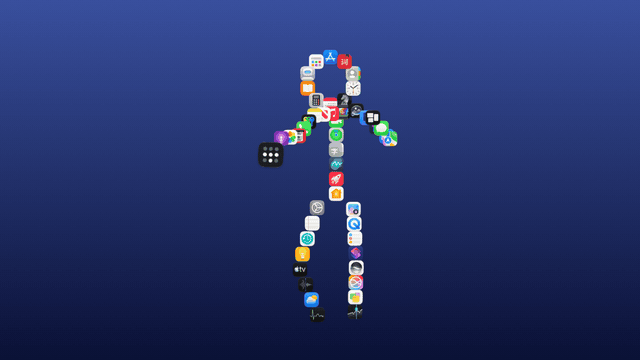
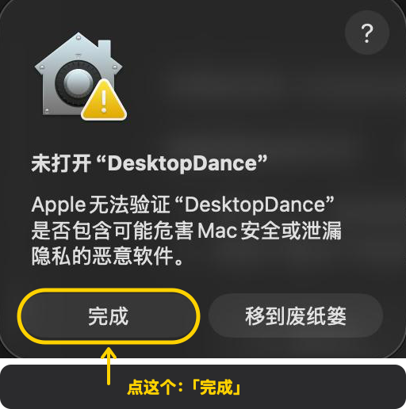
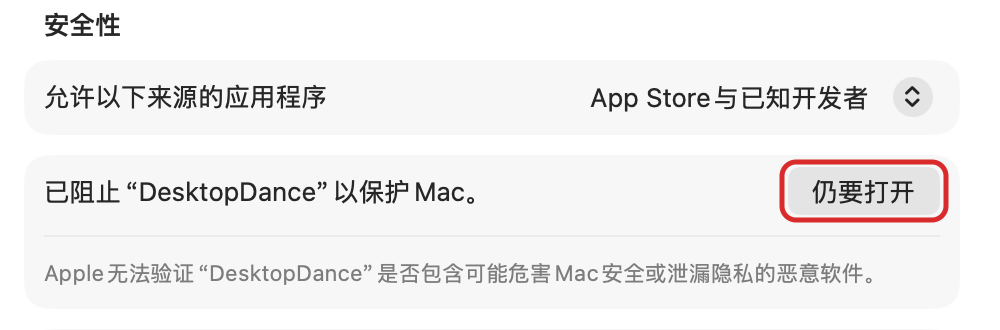
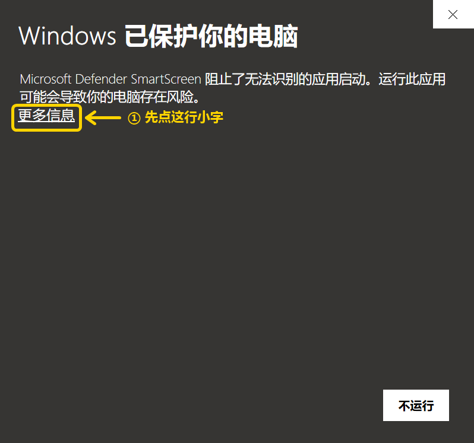
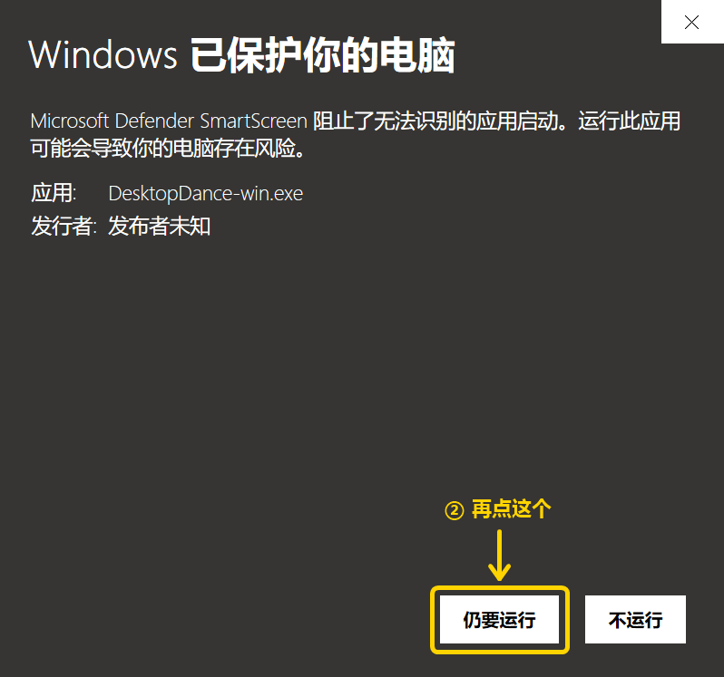
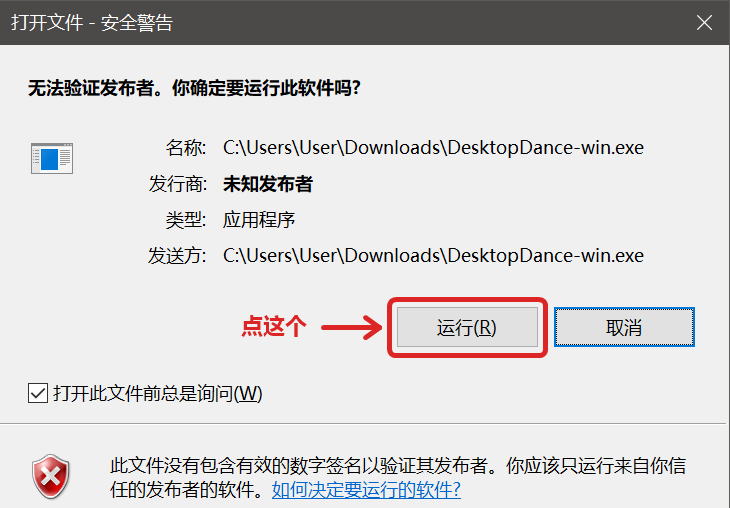
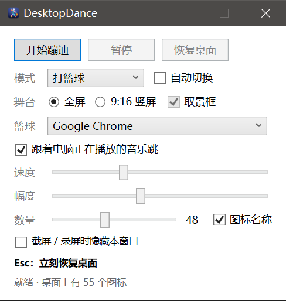

[English](README.md) | **中文**

# 桌面图标跳舞 · DesktopDance

**你桌面上的图标，会自己站起来打篮球。**

点一下「开始蹦迪」，桌面上的文件和应用图标就拼成一个小人：运球、转身，你放的歌越快，它打得越快。按一下 `Esc`，所有图标回到原位。

- 🏀 **四种玩法**：打篮球、列队、律动、自由
- 🎵 **跟着音乐跳**：听的是电脑正在放的歌，不用麦克风
- 🎯 **用你自己的图标**：桌面上有什么就用什么，哪个图标当篮球也由你挑
- 🔒 **不动你的文件**：不删、不改名、不移动，关掉程序桌面就是原样
- 💻 **Mac 和 Windows 都有**，非商业使用免费，源码公开



## 下载

<a href="https://github.com/jiafufang63-cpu/DesktopDance/releases/download/mac-v1.0/DesktopDance-mac.zip"></a>
&nbsp;&nbsp;
<a href="https://github.com/jiafufang63-cpu/DesktopDance/releases/download/win-v1.0/DesktopDance-win.exe"></a>

点上面的按钮就会开始下载，不用注册、不用登录。

- **不知道自己是哪种电脑？** 屏幕左上角有苹果图标的是 Mac；屏幕下方有四个小方块图标的是 Windows。
- **Mac** 需要系统是 macOS 14.2 或更新。查看方法：点屏幕左上角的苹果图标 → 「关于本机」。
- **Windows** 需要 64 位的 Windows 10 或 Windows 11。已在 Windows 10 上实测过；Windows 11 还没试过，遇到问题请[在这里留言告诉我](https://github.com/jiafufang63-cpu/DesktopDance/issues/new)（需要一个免费的 GitHub 账号）。

## Mac：怎么打开（只有第一次要多点几下）

**第 1 步：解压。** 下载完成后，打开「下载」文件夹，找到 `DesktopDance-mac.zip`，双击它。旁边会多出一个叫 `DesktopDance` 的图标（一个彩色小人）。（用 Safari 下载的话通常已经自动解压好了：「下载」里直接就有 `DesktopDance`，跳到第 2 步。）

**第 2 步：双击 `DesktopDance`。** 会弹出下面这个提示。这是正常的：苹果对所有没有向它付费的免费软件都会这样提示，不代表软件有问题。点 **「完成」**。（不要点「移到废纸篓」。）



**第 3 步：告诉电脑「我要打开它」。** 点屏幕左上角的苹果图标 → **「系统设置」** → 左边点 **「隐私与安全性」** → 右边一直往下翻，翻到「安全性」这几个字，下面有一行「已阻止 DesktopDance」，点它右边的 **「仍要打开」**。



**第 4 步：确认。** 再弹出一个窗口时，点 **「仍要打开」**，然后输入你的开机密码（或者按指纹）。

完成。以后直接双击 `DesktopDance` 就能打开，不用再做这几步。

> 找不到「仍要打开」？先回去再双击一次 `DesktopDance`，点「完成」，然后马上去「隐私与安全性」里看。这个按钮只在刚被拦住之后才出现。

## Windows：怎么打开（只有第一次要多点几下）

需要 64 位的 Windows 10 或 Windows 11。

**第 1 步：把下载的文件留下来。** 点了上面的下载按钮后，浏览器有时会拦一下，说这个文件「不常下载」或「可能有风险」。这是正常的：所有没有花钱买微软证书的新软件都会被这样提示，不代表它有问题。

- 用 **Edge** 浏览器：把鼠标移到这条提示上，点右边的 **「…」** → **「保留」**；如果它又问一次，点 **「显示详细信息」** → **「仍然保留」**。
- 用 **Chrome** 浏览器：点提示里的 **「保留」**。

没有出现这类提示的话，直接看第 2 步。

**第 2 步：找到下载好的文件。** 点屏幕下方任务栏里的黄色文件夹图标，在打开的窗口左边点 **「下载」**。里面有一个 `DesktopDance-win.exe`（有的电脑上名字只显示成 `DesktopDance-win`，是同一个文件）。

**第 3 步：双击它。** 会弹出一个大窗口（深灰色或蓝色），写着「Windows 已保护你的电脑」。这也是正常的，原因和第 1 步一样。这个窗口乍一看只有一个「不运行」按钮，先别点它：点那段文字下面的小字 **「更多信息」**，窗口下方会多出一个 **「仍要运行」** 按钮，点它。





有的电脑弹出的不是上面那个窗口，而是下面这个「打开文件 - 安全警告」。意思一样，点 **「运行」** 就行。



**第 4 步：等几秒。** 第一次打开要等几秒钟，然后屏幕**左下角**会出现一个小窗口，标题是 `DesktopDance`。看到它就成功了。



完成。以后直接双击这个文件就能打开，一般不会再出现这个提示。它不需要安装；想把文件挪到别的地方（比如拖到桌面上）也可以；以后不想要了，直接删掉这个文件就行。

> 双击之后什么都没出现？先等十秒钟，再看看屏幕最下面的任务栏里有没有 `DesktopDance`。个别杀毒软件会拦没有签名的新软件，如果它弹了提示，选「允许」。还是不行的话请[在这里留言告诉我](https://github.com/jiafufang63-cpu/DesktopDance/issues/new)。

## 怎么玩

1. 打开后，屏幕**左下角**会出现一个小窗口。（只有 Mac）刚打开时可能先问两件事：能不能访问「桌面」文件夹、能不能控制「访达」。都点「允许」/「好」，它只是读一下有哪些图标、在什么位置。然后点小窗口里的 **「开始蹦迪」**。
2. （只有 Mac）第一次会问能不能「录制系统音频」，点 **「允许」**。它需要听到你放的歌才能跟着跳；只是听节拍，不录音、不保存。
3. 用任何软件放一首歌（音乐软件、视频、网页都行），图标就会跟着动。
4. **想停下来：按键盘左上角的 `Esc` 键。** 桌面马上恢复原样。

## 常见问题

**它会弄乱或者删掉我桌面上的东西吗？**
不会。它只是在桌面上方「画」出图标的样子让它们动，你真正的文件一直待在原地，没有被移动、改名或删除。就算程序突然崩溃或者电脑死机，重新开机后桌面也是原样。

**我桌面上没什么东西，也能玩吗？**
能。图标不够的时候，它会借用你电脑里已安装软件的图标来凑数，只是借来显示，不会在你桌面上多出任何文件。

**按 `Esc` 没反应怎么办？**
点小窗口里的「恢复桌面」。还不行就直接关掉那个小窗口，桌面会立刻恢复。

**放着歌，它却不跟着跳？**
看一下小窗口里「跟着电脑正在播放的音乐跳」有没有打勾。Mac 上如果一直显示「没听到声音」：系统设置 → 隐私与安全性 → 录屏与系统录音 → 翻到最下面「仅系统录音」，把 DesktopDance 打开。

**怎么删掉它？**
Mac：把 `DesktopDance` 拖进废纸篓。Windows：删掉 `DesktopDance-win.exe`。它没有在电脑里安装别的东西，只会留下一个很小的设置和日志文件夹，位置见[隐私说明](PRIVACY.md)。

---

下面是更详细的说明，想了解每个按钮、或者想自己改代码的人可以接着看。从「权限弹窗」开始写的是 Mac 版；Windows 版对应的内容（怎么保证桌面不出事、已知限制、从源码构建）在 [windows/README.md](windows/README.md)。另见[隐私说明](PRIVACY.md)。

## 小窗口里每个选项是做什么的

| 控件 | 作用 |
| --- | --- |
| 开始蹦迪 / 暂停 / 恢复桌面 | 开始、暂停、图标飞回原位并撤掉舞台 |
| 模式 | 打篮球（默认）、列队、律动、自由；勾「自动切换」会轮流播 |
| 篮球 | 「打篮球」里用哪个图标当球，选了立刻换。默认用第一个应用图标（Windows 版是第一个图标）。菜单里列的是你这台电脑上场的那些图标（你的桌面文件和你装的应用），每个人看到的都不一样 |
| 跟着电脑正在播放的音乐跳 | 默认勾上。不勾或没声音时按内置的 120 拍跳 |
| 速度 / 幅度 / 数量 | 舞步快慢、摆动大小、图标总数（拖完松手，图标会按新数量重新排一次）。打篮球里「幅度」是动作夸张程度：默认位置是原样，越大手脚挥得越开（为了不出画，小人会相应缩小一些） |
| 图标名称 | 图标下面带不带名字。录视频建议关掉，小人轮廓更干净 |
| 截屏 / 录屏时隐藏本窗口 | 全屏录制时勾上，控制窗口就不会入镜（系统截图已验证有效；个别第三方录屏工具可能不理会这个设置） |
| 语言 | 界面用中文还是英文。第一次按系统语言定，改了会记住 |

**随时恢复：按 `Esc`**，也可以点「恢复桌面」或关掉控制窗口（Mac 上还可以按 `Command+Q`）。

「数量」是多少，就有多少个图标跳舞。桌面图标比它多时，多出来的留在原位不动；比它少时，用应用图标补位。暂停时改的数量和模式，会在点「继续」后生效。

创意来自 LXG 的 Windows 软件「桌面蹦迪」。那个软件没有公开源码，也没有 Mac 版；这里是从零写的独立实现，没有使用它的任何代码。

## 首次运行可能出现的权限弹窗（Mac）

| 弹窗 | 什么时候出现 | 不给会怎样 |
| --- | --- | --- |
| 录制系统音频 | 第一次开始跳舞时 | 听不到音乐，按内置节拍跳 |
| 访问「桌面」文件夹 | 启动时 | 读不到桌面图标，全部用应用图标补位 |
| 自动化（控制 Finder） | 桌面上有图标时 | 拿不到图标的真实位置，副本从默认网格出发 |

不需要「辅助功能」权限，**不会申请「屏幕录制」权限**，从不使用麦克风，不联网。

如果放着歌却一直显示「没听到声音」：系统设置 → 隐私与安全性 → 录屏与系统录音 → 最下面「仅系统录音」里打开 DesktopDance。

## 从源码构建（Mac）

Windows 版见 [windows/README.md](windows/README.md)。只需要 Xcode 命令行工具（没有的话先 `xcode-select --install`），不需要完整的 Xcode：

```bash
./build.sh
open build/DesktopDance.app
```

打一个可以发给别人的通用版压缩包（`dist/DesktopDance-mac.zip`）：

```bash
./release.sh
```

自己构建的 app 是临时签名，系统把权限绑在「某一次构建」上：重新构建后，系统可能会把之前给过的权限再问一遍。

## 怎么改

**歌词**：默认不显示。想在顶部叠歌词，用命令行带一个 `.lrc` 文件启动：`open build/DesktopDance.app --args --lyrics 你的歌词.lrc`，每行 `[分:秒.百分秒]歌词`，参考 [lyrics/placeholder.lrc](lyrics/placeholder.lrc)；歌词按自己的时间表循环，不和正在播的歌对齐。本地音频文件同理：`--audio 文件` 会改为播放并跟随那个文件。

**队形和舞步**都在 [Sources/Choreo.swift](Sources/Choreo.swift)，每个模式是一个函数：

| 想改什么 | 改哪里 |
| --- | --- |
| 列队：开场小列多长、几拍后拉长、几拍后弯成 S | `snake()` 开头的 `Lshort`、`grow`、`toS` |
| 列队：S 和 Y 各停多久 | `snake()` 里 48 拍一轮的那段 `bump(...)` |
| 列队：S 有几道弯、摆多宽 | `pS` 那两行里的 `1.25` / `1.5`（弯数）和 `0.30`（宽度） |
| 列队：波浪大小、倾斜角度 | `A`、`tilt` |
| 打篮球：换一段动作 | 见下面「打篮球的动作从哪来」，重新提取即可，不用改代码 |
| 打篮球：小人各部位分多少图标、头多大 | `figure()` 里的 `weights`、`headR` |
| 律动：压多扁、跳多高 | `groove()` 里的 `sy`、`sx`、`hop` |
| 自由：聚成多大一团、弹多远 | `free()` 里的 `R0`、`burst` |
| 自动切换时每个模式停多少拍 | `DanceMode.autoBeats` |

新增模式：在 `DanceMode` 里加一个 case，在 `poses()` 的 `switch` 里接上一个新函数，函数返回每个图标的 `Pose`（位置、旋转、缩放）即可，控制窗口的菜单会自动多出一项。

改完运行 `./build.sh`。想不开窗口先看队形，可以离屏渲染成图片：

```bash
./build/DesktopDance.app/Contents/MacOS/DesktopDance --render-test /tmp/dance-preview
```

## 打篮球的动作从哪来

「打篮球」不是手写的动作，而是**动作捕捉**：从一段全身入镜的运球视频里，用 macOS 自带的人体姿态识别逐帧取出 17 个关节的位置，再按颜色找出篮球，存成 [motion/basketball-motion.json](motion/basketball-motion.json)。小人就是照着这份数据动的，一轮 16.8 秒：低位运球 → 换手 → 球举到肩 → 指尖转球 → 抛球 → 转身、叉腿、伸臂，然后循环。球被抛走后，当球的图标会淡出，回到开头时再出现。

这个文件里**只有关节坐标**，不含任何视频画面，仓库里也不带视频。

想换成别的视频（别的舞、你自己跳的）：

```bash
./build/DesktopDance.app/Contents/MacOS/DesktopDance --extract-pose 你的视频.mp4 motion/basketball-motion.json --sheet /tmp/check.png --from 起始秒 --to 结束秒
```

然后 `./build.sh`。`--sheet` 会生成一张叠了骨架的检查图，用来确认识别得准不准。要求：单人、全身入镜、同一个机位（中途切镜头的话分段提取，或只取一段）。视频要是 H.264/HEVC 编码；VP9 的先用 `ffmpeg -i in.webm -c:v h264_videotoolbox out.mp4` 转一下。

找不到这个数据文件时，会退回一套手写的简化动作（`proceduralSkeleton()`）。

## 它怎么保证桌面不出事

程序**从不移动、隐藏、改名或删除任何真实图标，也不改任何 Finder 或系统设置**。它做的只有一件事：在桌面图标层正上方开一个属于自己的全屏窗口，在里面画图标的副本。

- 桌面上有真实图标时，窗口先铺一层壁纸把它们盖住，再画副本，看起来就是图标自己在跳。
- 桌面是空的时，窗口完全透明，直接在真实壁纸上跳。
- 这个窗口只活在本进程里。正常退出、崩溃、`kill -9` 强杀、断电重启——只要进程没了，窗口就没了，真实桌面原样露出来。不存在「需要恢复」的持久状态，所以也从不需要 `killall Finder`。
- 有遮罩时窗口会拦截鼠标（免得隔着遮罩误拖看不见的真实图标），点一下桌面就停止。
- 开始前会把图标坐标和叠放/排列设置存一份快照到 `~/Library/Application Support/DesktopDance/desktop-snapshot.json`，结束后重新读一遍核对，结果写进日志，发现有图标位置变了才在状态行提醒。只核对、不改动：即使发现有图标位置变了（比如你中途自己拖过），程序也不会去「写回」。
- 日志在同目录的 `desktop-dance.log`。

## 已知限制

- **有图标的桌面需要一张壁纸来盖住真图标**，用的是系统壁纸文件，不需要任何权限。如果你的壁纸是第三方软件画的（动态壁纸软件），壁纸文件会和屏幕上看到的不一样；这种情况下想要无缝，可以自己到 系统设置 → 隐私与安全性 → 录屏与系统录音 里手动加上 DesktopDance，程序发现有权限就会改用实时截取的壁纸。程序自己不会弹窗要这个权限。
- **动态壁纸**：有遮罩时铺的是一张静止的壁纸截图，动态壁纸在跳舞期间看起来会定住。桌面为空时没有遮罩，不受影响。
- 跳舞期间 `Esc` 被全局占用（为了随时能恢复），其他程序暂时收不到 `Esc`。
- 桌面文件用系统的 QuickLook 缩略图（和 Finder 显示的一致）；个别类型 1.5 秒内取不到缩略图时退回通用图标。
- 多显示器：只在主屏跳；放在其他屏幕上的桌面图标不上场，保持原样。
- 「打篮球」跟音乐的方式是**快慢**：歌快动作就快，歌慢动作就慢（100 拍为原速，0.75–1.4 倍之间平滑变化），不会在每个鼓点上抖一下。它不保证每次拍球正好踩在鼓点上。列队、律动、自由三个模式是逐拍跟的。

## 自测记录

主要在一台 macOS 27.0.1、4K@120Hz、Apple 芯片的 Mac 上测；另外用 GitHub 的机器在 macOS 15（Apple 芯片）、macOS 15（Intel）、macOS 26（Apple 芯片）上各跑了一遍。

已验证：

- 四种模式的队形（离屏渲染 + 真机截图）；真机稳定 118–120 fps
- 打篮球：动作数据 420 帧，人体全部识别到，篮球在抛出前的 260 帧里识别到 253 帧；和原始画面逐格对比 14 个时刻，姿势全部对得上；循环衔接处无跳变
- 跟随系统正在播放的声音（Core Audio 进程监听，只需「仅系统录音」权限）：接通、听到声音并锁定节拍
- `Esc` 全局热键恢复；`SIGTERM` 恢复后退出
- 逻辑自检（`--self-check`，用造出来的数据）：多显示器时别的屏幕上的图标不上场、选篮球时名字完全相同的优先、坏的动作文件不会让程序崩、1 到 140 个图标四个模式都能排出位置
- 用脚本模拟操作的回归：暂停时改数量和模式（保持暂停，继续后生效）、跳舞中改数量、连续快速开关「跟着音乐」、幅度拉到最大时不出画
- **真实桌面，28 个图标**（文件夹、长文件名、中文/日文/emoji 文件名、图片、PDF、压缩包、网址、符号链接）：副本和真图标位置重合；遮罩盖住真图标；四个模式都跑过；停止后复核「28 个图标位置未变」
- **真实桌面，20 个图标，「数量」设 12**：12 个在跳，其余 8 个留在原位；选一个留在原位的图标当篮球，它会自动换上场；「数量」调到 30 后 20 个全部上场、再借 10 个应用图标；停止后位置未变
- 跳舞中 `kill -9` 强杀：舞台窗口立即消失，Finder 里每个图标的坐标与之前逐字一致；下次启动能识别上次异常退出
- 用壁纸文件做遮罩（默认方式）：能正常铺上
- 全程 `~/Desktop` 内容、Finder 的桌面设置均未被改动

- **其他系统和 Intel**：在 macOS 15（Apple 芯片）、macOS 15（Intel）、macOS 26 三台 GitHub 机器上，从源码构建、逻辑自检、开窗口轮流跳四个模式、中途改数量、停止并恢复桌面，全部通过。这些机器桌面是空的、没有声音，所以只能说明程序能正常启动、运行和退出，画面和跟拍没有人看过

**没能验证**：

- macOS 14（GitHub 已不提供这个版本的测试机器；程序声明的最低要求是 14.2）
- 在 Intel 的 Mac 和 macOS 15、26 上：有真实桌面图标时的遮盖效果、跟着音乐跳
- 多显示器（「其他屏幕上的图标不上场」这条逻辑没有第二块屏幕可测）
- 跳舞中途换输出设备（插拔耳机）后自动重新接上声音
- 桌面开着「使用叠放」时的表现
- 壁纸文件做的遮罩和系统壁纸是否完全对齐（测试机的壁纸由第三方软件绘制，没法比对）

遇到问题按 `Esc` 即可，桌面不会受影响；欢迎提 issue。

## 许可证

© 2026 Jennifer Fang。采用 [PolyForm Noncommercial 1.0.0](LICENSE) 许可：个人和非商业用途可以免费使用、修改、分享，需保留署名和许可说明；**不允许任何商业用途**（包括出售、收费分发、放进收费产品或服务里）。需要商业授权请在本仓库提 Issue 联系作者。
